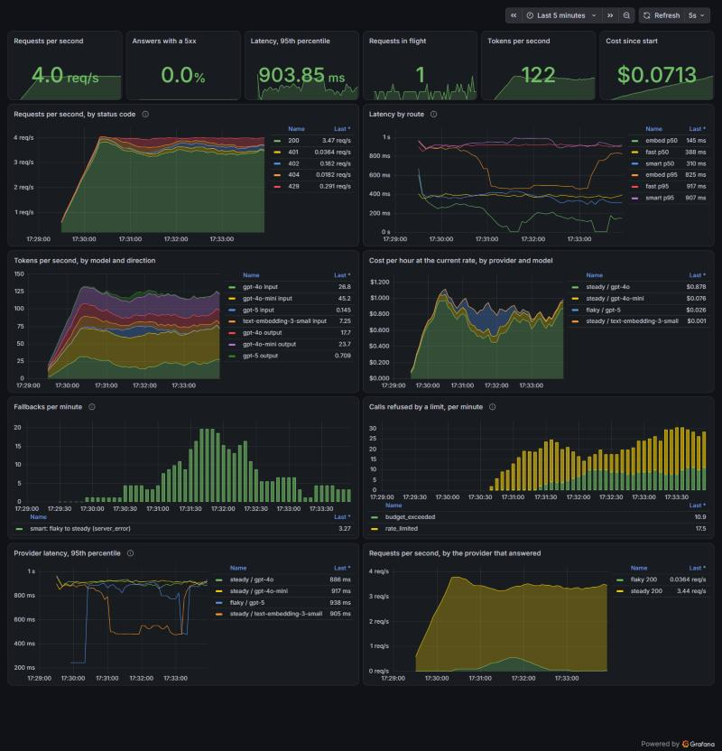

# transponder demo

transponder in front of a fake provider, with calls flowing through it and a Grafana dashboard that shows requests, latency, tokens, cost, fallbacks and limits. Traces go to Jaeger. Nothing leaves your machine and no provider key is needed.



## Run it

You need Docker with Compose v2 and about 4 GB of disk for the images, most of it the Go build image and Grafana.

```shell
git clone https://github.com/raven-clown/transponder.git
cd transponder/demo
docker compose up --build -d --wait
```

Then open:

| | URL | |
|---|---|---|
| Dashboard | http://localhost:3000 | Grafana opens on the transponder dashboard. Data shows within a minute. Sign in as `admin` / `admin` to edit. |
| Traces | http://localhost:16686 | Jaeger. Pick the service `transponder` and click Find Traces. |
| Prometheus | http://localhost:9090 | Try `sum by (code) (rate(transponder_requests_total[1m]))`. |
| Gateway | http://localhost:8080 | The OpenAI and Anthropic APIs, with the keys below. |

The first `up` downloads the images and compiles transponder: about 80 seconds on a fast connection with the Go image already there, longer on a slow one. Later starts take about 25 seconds. Every panel has data within a minute after that.

If a port is taken, choose another before `up`, such as `DEMO_GRAFANA_PORT=3001`. The variables are `DEMO_GATEWAY_PORT`, `DEMO_GRAFANA_PORT`, `DEMO_PROMETHEUS_PORT` and `DEMO_JAEGER_PORT`.

`./check.sh` checks a running demo from outside and says what is missing, if anything. CI runs it on every pull request.

Stop it, and delete its data, with:

```shell
docker compose down -v
```

## What runs

| Service | What it is |
|---|---|
| `transponder` | The gateway, built from this repository with [`transponder.yaml`](transponder.yaml). |
| `upstream` | A fake OpenAI-compatible provider: chat, streamed chat, the Responses API (plain and streamed) and embeddings, with made-up answers after 80 to 600 ms. |
| `flaky` | The same, answering 503 to about a third of its calls. |
| `seed` | Puts five API keys in the store before the gateway starts, then exits. |
| `traffic` | Sends about four calls a second through the gateway, Responses API calls included. |
| `prometheus` | Scrapes `/metrics` every 5 seconds on the gateway's ops port, where no key is needed. |
| `grafana` | The dashboard, provisioned from [`grafana/`](grafana). |
| `jaeger` | Takes the traces over OTLP on port 4318 and shows them. |

`upstream`, `flaky`, `seed` and `traffic` are one small program in [`sim/`](sim). It is for this demo only and is not part of transponder.

## What you see

The routes and limits in [`transponder.yaml`](transponder.yaml) are set up so every panel has something to show:

- `fast` and `embed` go to the provider `steady`, which is the `upstream` service, as the models `gpt-4o-mini` and `text-embedding-3-small`. Their real prices apply, so the cost panel shows what the same traffic would cost there.
- Some calls use the Responses API (`/v1/responses`), plain and streamed, on `fast`. Their endpoint shows as `responses` on the requests panel and in Jaeger, with their tokens, cached and reasoning tokens, and cost.
- `smart` tries the provider `flaky` as `gpt-5` first and falls back to `steady` as `gpt-4o`. The fallback panel shows `smart: flaky to steady (server_error)`. After three failures in a row `flaky` cools down for 30 seconds and is tried last, so the fallbacks come in waves.
- The key `batch` may make 10 calls a minute and is sent about 36, so the limit panel shows `rate_limited`.
- The key `trial` has a daily budget of a fifth of a cent. It is spent within a minute or two, and then the limit panel shows `budget_exceeded`.
- A few calls use a key that does not exist (401) or a model with no route (404).

In Jaeger, a call on `smart` that fell back has one span for the call and one for each provider it tried, the first marked as an error with its reason. The spans carry the provider, model, status, tokens and cost, never the prompt or the answer.

## Call it yourself

The keys are fixed so this page can name them. They are public, so never use this setup outside your machine.

| Key | What it is for |
|---|---|
| `tp_demo_alice`, `tp_demo_bob` | Ordinary callers |
| `tp_demo_batch` | 10 calls a minute |
| `tp_demo_trial` | A fifth of a cent a day |
| `tp_demo_viewer` | The `viewer` role, which may read `/metrics` on the gateway's port |

```shell
curl http://localhost:8080/v1/chat/completions \
  -H "Authorization: Bearer tp_demo_alice" \
  -d '{"model":"smart","messages":[{"role":"user","content":"hello"}]}' -i
```

The answer's headers name the provider that answered (`X-Transponder-Provider`), how many targets it fell back past (`X-Transponder-Fallbacks`), and the tokens and cost (`X-Usage-*`). Send a `traceparent` header and the call joins your trace.

```shell
curl http://localhost:8080/v1/usage -H "Authorization: Bearer tp_demo_trial"
curl http://localhost:8080/metrics -H "Authorization: Bearer tp_demo_viewer"
```

The gateway also printed an admin key when it first started: `docker compose logs transponder | grep tp_`.

## Use your own provider

Replace a provider in `transponder.yaml` with a real one, for example:

```yaml
providers:
  - {name: steady, type: openai, api_key: "${OPENAI_API_KEY}"}
```

and pass the key through to the container in `docker-compose.yml` under `transponder.environment`. Stop the `traffic` service first, or it will spend your money: `docker compose stop traffic`.
