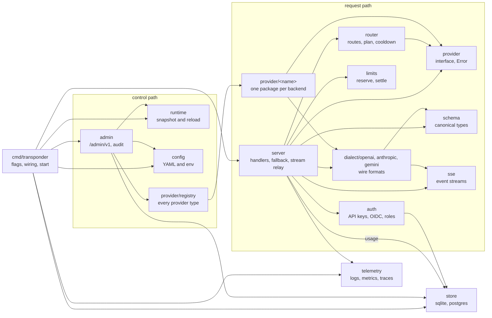
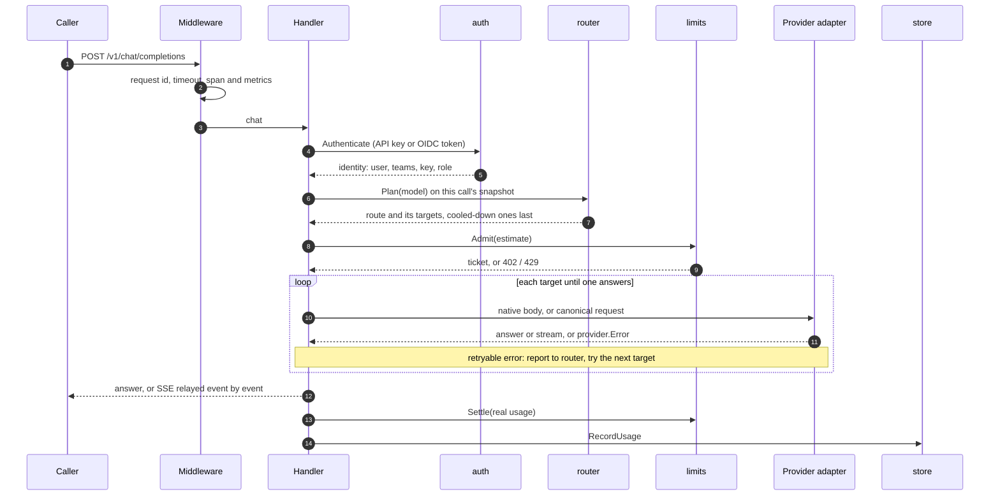
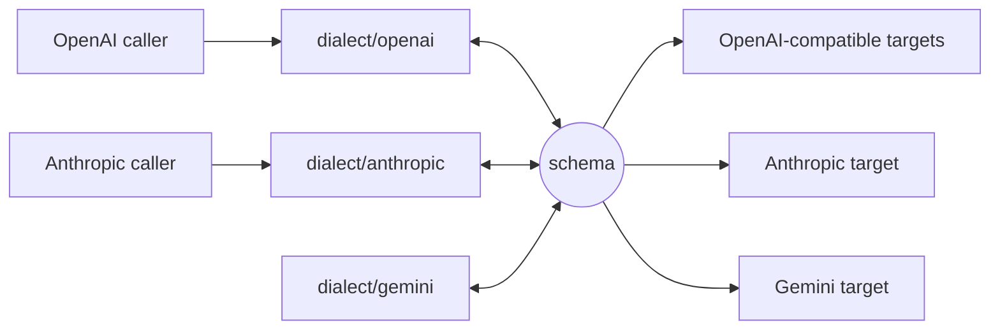

# Architecture

How transponder's code is put together and why, for someone reading it for the first time. [design.md](design.md) is the plan it was built from; this page is the code as it stands, with a pointer to the file behind every claim.

## Contents

- [In one paragraph](#in-one-paragraph)
- [Package map](#package-map)
- [The life of one chat request](#the-life-of-one-chat-request)
- [Design choices](#design-choices)
- [What the code avoids on purpose](#what-the-code-avoids-on-purpose)
- [How it is tested](#how-it-is-tested)
- [Add a provider](#add-a-provider)
- [Add a dialect](#add-a-dialect)

## In one paragraph

A call comes in speaking one API (OpenAI or Anthropic), is checked for who sent it, matched to a route, admitted by the limiter, and tried on the route's targets in order until one answers. When the caller and the target speak the same API, the body goes through untouched except for the model name. When they don't, the request is decoded into one canonical type, encoded for the target, and the answer comes back the same way. Usage is counted, priced and written once the call ends. The config that drives all of this (providers, routes, budgets, profiles) lives in the database and is swapped in whole when it changes, so a call never sees half a change.

## Package map

Arrows point from a package to what it imports. A few things the map shows:

- `schema` and `sse` import nothing from the project. Every dialect and adapter depends on them, and they depend on nobody.
- `runtime` and `limits` import nothing from the project either. `runtime.Reloader[T]` reloads any value, and `limits` counts through its own `Store` interface, so neither knows about SQL or HTTP.
- `server` knows the two dialects callers speak, OpenAI and Anthropic. Gemini is a dialect only targets speak, so only its adapter imports it.
- `cmd/transponder` is the only place that knows every concrete type. It builds the stores, the providers and the server and passes each what it needs.

## The life of one chat request

Step by step, with the code for each:

1. **Middleware.** `server.New` in [`internal/server/server.go`](../internal/server/server.go) wraps the mux in `RequestID` ([`requestid.go`](../internal/server/requestid.go)), the request timeout, and `observe` ([`observe.go`](../internal/server/observe.go)), which starts the span and counts the request.
2. **Sign-in.** `beginWith` in `server.go` calls `auth.Authenticator.Authenticate` ([`internal/auth/auth.go`](../internal/auth/auth.go)). A JWT goes to the OIDC verifier ([`oidc.go`](../internal/auth/oidc.go), keys cached by [`jwks.go`](../internal/auth/jwks.go)); anything else is hashed and looked up as an API key. The result is an `auth.Identity` on the request context.
3. **The snapshot.** `beginWith` reads the router and limiter once, through `Deps.Live`, and keeps them on the `call`. Everything after uses that pair, so a reload in the middle of the call changes nothing for it.
4. **Routing.** `router.Plan` ([`internal/router/router.go`](../internal/router/router.go)) finds the first route that matches the model, checks `allow` ([`access.go`](../internal/router/access.go)), and returns the targets with any in cooldown moved to the end.
5. **Limits.** `gateway.admit` ([`internal/server/limits.go`](../internal/server/limits.go)) estimates the input ([`internal/tokens`](../internal/tokens)) and asks `limits.Limiter.Admit` ([`internal/limits/limiter.go`](../internal/limits/limiter.go)) for a ticket. The ticket reserves the dearest target's price up front.
6. **Fallback.** `gateway.run` ([`internal/server/upstream.go`](../internal/server/upstream.go)) calls one attempt per target. An attempt is either *native*, the caller's body with only the model rewritten (`openai.RewriteRequest` in [`internal/dialect/openai/native.go`](../internal/dialect/openai/native.go)), or *canonical*, decoded into `schema.ChatRequest` and handed to `Provider.Chat` or `ChatStream`. A retryable error reports the target to the router and moves on; a bad request or a gone caller stops the loop.
7. **Streaming.** [`internal/server/stream.go`](../internal/server/stream.go) relays a stream event by event. [`opening.go`](../internal/server/opening.go) holds back events that carry no output yet, such as a role chunk or `message_start`, so a target that fails right after them can still fall back without the caller seeing anything.
8. **After.** The handler settles the ticket at the real usage, prices it ([`internal/pricing`](../internal/pricing)), sets the `X-Usage-*` headers or trailers, and records the usage through `store.UsageStore`. SQLite batches the records of calls that finish together into one transaction ([`internal/store/sqlite/usage.go`](../internal/store/sqlite/usage.go)).

## Design choices

Each choice names the file that shows it and why it was made.

### Small interfaces instead of class hierarchies

`provider.Provider` in [`internal/provider/provider.go`](../internal/provider/provider.go) has five methods: `Name`, `Dialect`, `Chat`, `ChatStream` and `Embed`. A backend that can also forward a body unchanged implements the separate one-method `provider.Native`, and the server finds out with a type assertion (`nativeTarget` in [`upstream.go`](../internal/server/upstream.go)). Nothing inherits from anything.

The store works the same way. [`internal/store/store.go`](../internal/store/store.go) splits it by what a caller needs: `KeyStore` for the gateway's key lookup and `KeyAdminStore` (which embeds it) for the admin API, `UsageStore` and `UsageAdminStore`, `ConfigItemStore`, `AuditStore` and `ConfigStore`. `server.Deps.Usage` is a `store.UsageStore`, so the gateway cannot touch keys or config even by mistake, and a test can hand it a fake with three methods.

Why: an interface the size of what its user calls is cheap to fake in a test, and a new backend only has to write the methods that matter.

### One adapter, many presets

Most providers speak the OpenAI API. They all use one adapter, `openai.Adapter` in [`internal/provider/openai/openai.go`](../internal/provider/openai/openai.go), configured by `openai.Options` (name, base URL, key, HTTP client, and whether to send `max_completion_tokens`). A package such as [`internal/provider/xai/xai.go`](../internal/provider/xai/xai.go) is a default base URL and a call to `openai.New`, about twenty lines. Anthropic and Gemini have adapters of their own, since their wire formats differ.

Why: a fix to the OpenAI wire format reaches every compatible provider at once, and a new compatible provider is one small package.

### The registry is the factory

[`internal/provider/registry/registry.go`](../internal/provider/registry/registry.go) lists every provider type once, with a constructor, whether it needs a `base_url`, and whether it is free (local models cost nothing in usage records). Config validation, `buildRouter` in `cmd/transponder`, the admin API and the free flag used when pricing a call all read this one list. A type that is not in it does not exist anywhere else.

Why: adding a provider is one entry, not a hunt for every `switch` on the type name.

### The canonical schema is a hub

[`internal/schema/schema.go`](../internal/schema/schema.go) defines one chat request, one response, one stream of events and one usage type. Each dialect package converts its wire format to and from these types:

With N dialects that is N translator pairs, not one for every pair of dialects. Messages carry ordered content parts (`schema.Part`), so text and images keep their order across every translation. Content a target cannot carry, such as an image at a URL for Gemini, comes back as a `schema.ContentError`, which the adapter wraps with `provider.CannotCarry` so the gateway skips that target.

When the caller and the target speak the same dialect, the hub is skipped: the native path forwards the body with only `model` changed, so features transponder does not know about still work.

### Middleware as decorators

Cross-cutting work wraps `http.Handler`: `RequestID`, the request timeout, and `observe` for metrics and traces, each a function from handler to handler (`server.New` in [`server.go`](../internal/server/server.go)). Sign-in is not middleware: `beginWith` does it inside the handler, because a refusal has to be written in the caller's dialect (OpenAI's `error.code` or Anthropic's `error.type`), which only the handler knows.

Why: each wrapper does one thing, and the order they run in is the order they are written.

### Copy-on-write config reload

[`internal/runtime/runtime.go`](../internal/runtime/runtime.go) keeps the live config in an `atomic.Pointer[Snapshot[T]]`. Every 2 seconds it reads the config version from the store; when it moved, it loads and validates the whole config, builds a new router and limiter, and swaps the pointer. A config that fails to load leaves the old pointer in place and is reported in `/admin/v1/status`. `Router.KeepHealth` carries the cooldown record into the new router, so a reload does not forgive a failing target.

Why: a read on the request path is one atomic load with no lock, and a call keeps the snapshot it started with even if a reload lands halfway through.

### Admin writes in one transaction

Every admin API write goes through `commit` in [`internal/admin/audit.go`](../internal/admin/audit.go). It runs the change and its audit record inside one `ConfigStore.UpdateConfig`, which raises the config version in the same transaction, then reloads before answering. Before it commits, the whole config is loaded as it would be after the write, and a write that would leave a config that does not load is refused with 400 `invalid_config`.

Why: an audit record can never be missing for a change, and a replica can never see half a change.

### Stream encoders are small state machines

Turning canonical events into Anthropic's stream means tracking which content block is open and which tool calls are still arriving. `anthropic.StreamEncoder` in [`internal/dialect/anthropic/stream.go`](../internal/dialect/anthropic/stream.go) holds exactly that state and nothing else: `Frames(event)` returns the frames for one event, and `End()` closes what is still open. The decoders on the other side (`anthropic.StreamDecoder`, the OpenAI chunk reader in [`internal/dialect/openai/stream.go`](../internal/dialect/openai/stream.go)) do the reverse, one event at a time.

Why: a stream is relayed as it arrives, so each step can only depend on what came before. Keeping that state in one small type makes it easy to fuzz.

### Typed errors drive fallback

An adapter that fails returns a `*provider.Error` with the HTTP status, the body and `Retryable`, set by `provider.RetryableStatus` (408, 429, 5xx, and 401 or 403, which mean the gateway's own provider key is bad). `gateway.run` reads only that flag to decide whether the next target may succeed. `provider.ErrUnsupported` means "this target cannot take this request" and skips it without counting it as a failure.

Why: the fallback rule lives in one place, and an adapter only has to say what happened, not what to do about it.

### Limits reserve, then settle

`limits.Limiter.Admit` takes the call's estimate and reserves it against every budget, allowance, rate and concurrency cap that applies, then returns a ticket. When the call ends, the ticket settles at the real usage. The counters sit behind `limits.Store` ([`internal/limits/store.go`](../internal/limits/store.go)): `MemoryStore` for one process, the shared Postgres counters in [`internal/store/postgres/counters.go`](../internal/store/postgres/counters.go), and `Failover` ([`failover.go`](../internal/limits/failover.go)) for when Postgres cannot be reached.

Why: two calls in flight cannot both spend the last of a budget, on one replica or on many.

## What the code avoids on purpose

- **Deep inheritance.** Go has no classes, and the code does not imitate them. Embedding is used only to build a bigger interface from a smaller one (`KeyAdminStore` embeds `KeyStore`), never to share behaviour between types.
- **Dependency injection frameworks.** `serve` in [`cmd/transponder/main.go`](../cmd/transponder/main.go) builds every dependency by hand and passes it in a struct (`server.Deps`). Reading `serve` top to bottom shows everything the process starts, in order.
- **ORMs.** SQL is written by hand in [`internal/store/sqlite`](../internal/store/sqlite) and [`internal/store/postgres`](../internal/store/postgres), with numbered migrations embedded in each. A query that is slow or wrong is visible in the file, and the two engines can differ where they need to (SQLite batches usage writes, Postgres counts limits).
- **Global mutable state.** Package-level values are tables that never change after start, such as `registry.specs` and the embedded price table. Clocks are passed in as `func() time.Time`, so tests control time.
- **Reflection on the request path.** The only reflection is in `config`, mapping `TRANSPONDER_` variables to keys at start.

Generics are used where one piece of code really is the same for any type: `runtime.Reloader[T]` and the stream opener `open[T]` in [`opening.go`](../internal/server/opening.go).

## How it is tested

- **Table-driven tests** with `t.Run` subtests, through each package's public API. No test calls the network: providers are `httptest` servers, some replaying recorded bodies (such as [`internal/server/testdata/responses`](../internal/server/testdata/responses)).
- **One store suite, two engines.** [`internal/store/storetest`](../internal/store/storetest) is the contract every store meets: keys, usage, config items, audit, config versions, and a check that migrations only expand. `sqlite_test.go` and `postgres_test.go` each call `storetest.Run`. The Postgres run needs `TRANSPONDER_TEST_POSTGRES`, and [`pgtest`](../internal/store/postgres/pgtest) gives each test an empty schema of its own.
- **One limits suite, every counter store.** [`internal/limits/limitstest`](../internal/limits/limitstest) runs against `MemoryStore` and the Postgres counters.
- **A local identity provider.** [`internal/auth/authtest`](../internal/auth/authtest) serves a discovery document and JWKS and signs tokens, which the OIDC tests use for valid, expired, wrong-audience, unknown-key and rotated-key cases.
- **Fuzz targets** wherever input comes from outside: the request decoders of every dialect, the SSE reader, the stream translation, the model rewrite on the native path, and `${VAR}` expansion in config. Find them with `grep -rn "func Fuzz" internal`.
- **The race detector** runs on every test in CI (`go test -race ./...`).
- **Contract checks on docs and specs.** [`internal/admin/spec_test.go`](../internal/admin/spec_test.go) checks the served routes against [`api/openapi.yaml`](../api/openapi.yaml) both ways and validates every response the tests get. `TestConfigReference` keeps [configuration.md](configuration.md) in step with the config struct, and `TestDocsConfigExamples` loads every config example in the docs. [`demo/sim`](../demo/sim) checks that every Grafana query names a metric the gateway serves.
- **Speed.** Hot paths have Go benchmarks in `*_bench_test.go` next to their code, and [`bench/`](../bench) is a load suite with a fake provider. [benchmarks.md](benchmarks.md) has the method and the numbers.

## Add a provider

Most providers speak the OpenAI API. For one of those:

1. Make `internal/provider/<name>/<name>.go` with a `DefaultBaseURL` and a `New` that calls `openai.New`, as [`xai.go`](../internal/provider/xai/xai.go) does. Link the provider's docs next to the URL.
2. Copy [`xai_test.go`](../internal/provider/xai/xai_test.go): it checks the default base URL, that a `base_url` overrides it, and that the key goes out as a bearer token, against an `httptest` server.
3. Add one entry to `specs` in [`registry.go`](../internal/provider/registry/registry.go), with `NeedsBaseURL` if there is no sensible default and `Free` for a local server, and a row to `TestLookup` in `registry_test.go`.
4. Add the provider to the provider table in the README. A test reads that table and fails until the new type is in it with the right dialect and default URL.
5. If you know its prices, add them to [`internal/pricing/prices.yaml`](../internal/pricing/prices.yaml) with a link to the provider's price page. Without prices, calls are recorded as unpriced.
6. Add a line to `CHANGELOG.md` under Unreleased.

A provider with a wire format of its own needs more:

1. A dialect package under `internal/dialect/<name>` that encodes `schema.ChatRequest` and decodes the response, the stream and the usage. See [`internal/dialect/gemini`](../internal/dialect/gemini).
2. An adapter that implements `provider.Provider` on top of it, as [`internal/provider/gemini`](../internal/provider/gemini) does. Return a `*provider.Error` built with `provider.RetryableStatus` for a failed call, `provider.ErrUnsupported` for an operation it does not have, and wrap encoding errors with `provider.CannotCarry`.
3. Implement `provider.Native` too if callers can speak this format, so their bodies go through unchanged.
4. A fuzz target for each decoder, then steps 3 to 6 above.

## Add a dialect

A dialect callers can speak, such as a new inbound API, touches the server as well:

1. **Wire format.** In `internal/dialect/<name>`, decode the request into `schema.ChatRequest`, encode `schema.ChatResponse`, write errors in that API's shape, and add a stream encoder from `schema.Event` to its frames. [`internal/dialect/anthropic`](../internal/dialect/anthropic) is the model: `messages.go` for requests and responses, `stream.go` for the encoder and decoder, `errors.go` for errors.
2. **Handler.** Add a handler in `internal/server` like `messages` in [`messages.go`](../internal/server/messages.go): start with `beginWith` and the dialect's error writer, then `resolve`, `admit`, and `run` with a native attempt for targets of the same dialect and a canonical one for the rest.
3. **Route.** Register the path in `server.New` and give the handler its own `endpoint` name, which becomes the `endpoint` label in metrics. Document it in the README's metrics table.
4. **Tests.** Native and translated, plain and streamed, against `httptest` upstreams of each dialect; the usage headers on success, on errors and as stream trailers; and fuzz targets for the new decoders.
5. A line in `CHANGELOG.md` and a section in the README.
